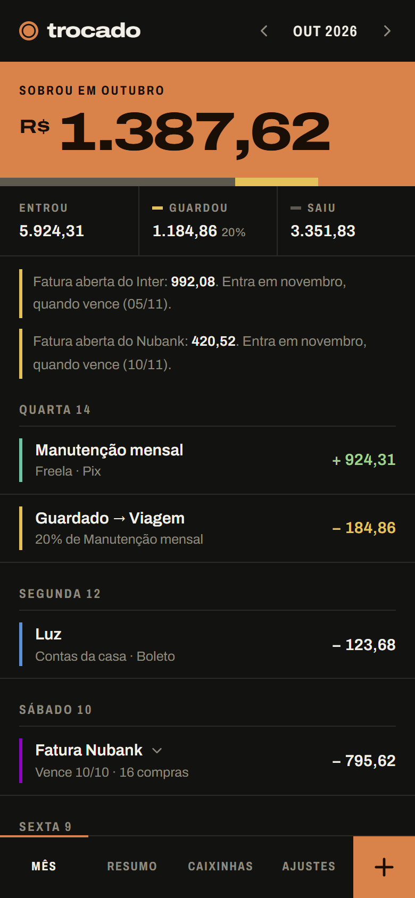
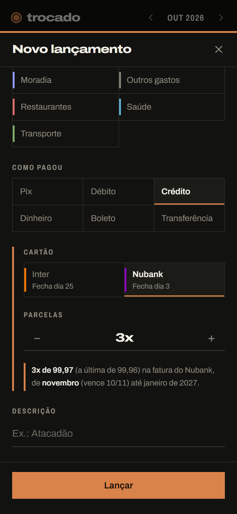
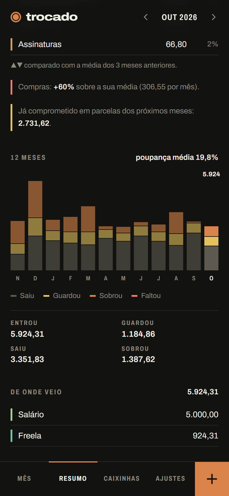
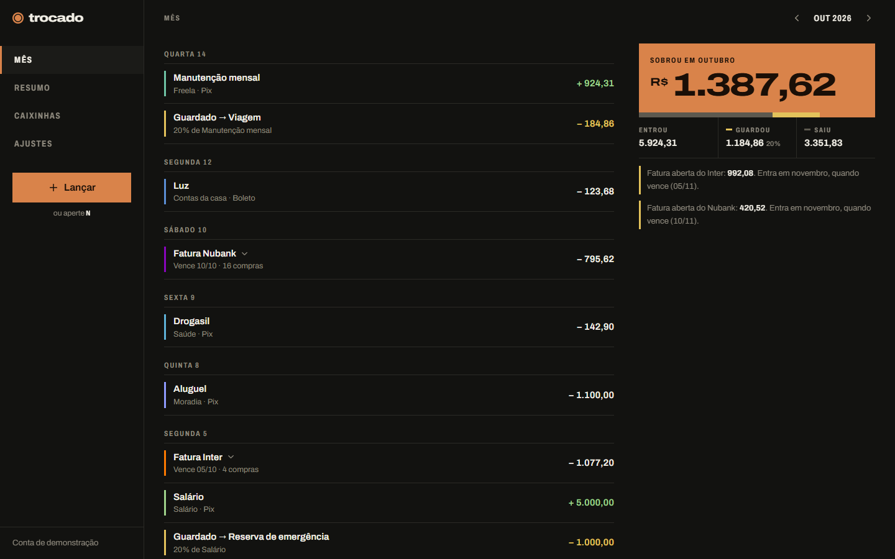

# trocado

Controle de gastos pessoal: quanto entra, quanto sai, quanto você guarda e quanto sobra no fim do mês.

Feito para uso próprio, com renda que varia de um mês para o outro, e para mostrar como resolvo um problema de ponta a ponta: regra de negócio com teste, API, interface e deploy em Docker.

<p>
  
  
  
</p>



## O que faz

- **Entradas e gastos por categoria**, com o mês mostrando o que sobrou em destaque.
- **Guardar sempre uma parte**: ao lançar uma entrada, o app sugere guardar um percentual dela (20% por padrão) numa caixinha. Dá pra mudar o valor na hora.
- **Caixinhas** (reserva de emergência, viagem, carro…) com meta, extrato e transferência entre elas.
- **Cartão de crédito pelo mês da fatura**: cada compra, e cada parcela, conta no mês em que a fatura vence, que é quando o dinheiro sai da conta. O formulário mostra em que fatura a compra vai cair antes de salvar.
- **Resumo**: gastos por categoria comparados com a média dos 3 meses anteriores, os últimos 12 meses em colunas (saiu, guardou, sobrou), taxa de poupança e quanto já está comprometido em parcelas futuras.
- **PWA**: instala no celular e abre como app. Tema escuro (padrão) e claro.

## Regras que valem destaque

| Regra | Onde |
|---|---|
| Guardar não é gasto e resgatar não é renda. Os dois mexem no que sobrou, mas não entram nos gráficos de gasto e de entrada. | `backend/src/modules/resumo` |
| A compra entra na fatura que fecha depois dela; comprar no dia do fechamento já vai para a seguinte. Vencimento antes do fechamento empurra a fatura um mês. Dia 31 em mês curto vira o último dia. | `backend/src/modules/cartoes/fatura.ts` |
| Parcelas somam exatamente o total; os centavos que sobram vão para as primeiras (100,00 em 3x = 33,34 + 33,33 + 33,33). | `backend/src/shared/dinheiro.ts` |
| Nenhuma operação pode deixar uma caixinha negativa: resgatar demais, transferir demais ou tirar o valor guardado de uma entrada antiga é recusado e a transação inteira volta. | `backend/src/modules/caixinhas/saldos.ts` |
| Dinheiro sempre em centavos inteiros; datas como texto `AAAA-MM-DD`, sem hora, para um gasto das 23h não cair no dia (ou no mês) seguinte por causa do fuso. | `backend/prisma/schema.prisma` |

As regras têm testes de unidade, e a API tem testes de ponta a ponta contra um Postgres de verdade, incluindo isolamento entre contas (`backend/test`).

## Stack

- **Backend:** Node 24, Express 5, TypeScript, Prisma 6, PostgreSQL 17, Zod, Vitest + Supertest.
- **Frontend:** React 19, Vite, Tailwind CSS 4, TanStack Query, React Router, PWA (vite-plugin-pwa). Gráficos feitos à mão, sem biblioteca.
- **Infra:** Docker Compose (Postgres, API e nginx servindo o app e repassando `/api`), GitHub Actions.

Sessão em cookie `httpOnly` com JWT, senha com bcrypt, limite de tentativas de login e cada consulta filtrada pela conta de quem está logado.

## Rodando com Docker

```bash
cp .env.example .env
```

Preencha no `.env` pelo menos `POSTGRES_PASSWORD`, `JWT_SECRET` e a sua conta (`USUARIO_NOME`, `USUARIO_EMAIL`, `USUARIO_SENHA`). A conta é criada quando o backend sobe, se ainda não existir uma com esse e-mail. Depois:

```bash
docker compose up -d --build
```

O app abre em http://localhost:8070. As migrations rodam sozinhas quando o backend sobe.

Para ter 12 meses de dados fictícios numa conta de demonstração (`demo@trocado.app` / `demonstracao`):

```bash
docker compose exec backend npm run db:popular:prod
```

Com `DEMO=true` no `.env`, a tela de entrada oferece o botão "Entrar na demonstração". É para a instância pública do portfólio, separada da que guarda dados reais.

## Desenvolvimento

O banco roda no Docker e fica acessível na sua máquina em `127.0.0.1:5433` (porta `DB_PORT`).

```bash
docker compose up -d db
cd backend && cp .env.example .env   # ajuste a senha do banco
npm install && npx prisma migrate deploy && npm run dev
```

```bash
cd frontend && npm install && npm run dev   # http://localhost:5190
```

O Vite repassa `/api` para `http://localhost:8070` (o backend no Docker). Para usar o backend rodando fora do Docker, defina `API_PROXY=http://localhost:3000`.

Testes do backend (precisam do Postgres do compose de pé):

```bash
cd backend && npm test
```

Cada execução cria um schema próprio no banco `trocado_teste`, aplica as migrations e remove o schema no fim.

## Estrutura

```
backend/
  prisma/              esquema e migrations
  src/modules/         conta, categorias, cartoes, caixinhas, lancamentos, resumo
  src/shared/          datas, dinheiro, erros, autenticação, validação
  src/scripts/         gerador da conta de demonstração
  test/                regras e API
frontend/
  src/pages/           Mês, Resumo, Caixinhas, Ajustes, Entrar
  src/components/      formulário de lançar, gráficos, painel lateral, campos
  src/api/             cliente HTTP, tipos e consultas (TanStack Query)
design/                direções visuais testadas antes de codar
```
